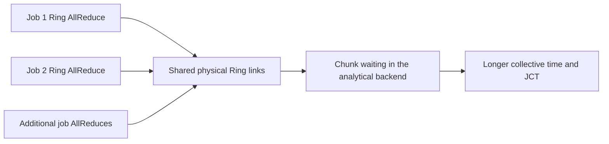

# How the experiment creates network contention

## Short answer

The Python code does not call a function named `create_contention`. It creates
contention by starting several independent Ring AllReduces at overlapping
times and placing their ranks so the collectives request shared physical Ring
links. ASTRA-sim's congestion-aware analytical backend models the resulting
waiting.

## Conditions required for contention

The experiment combines four choices:

1. Every job has the same 100-us compute phase, so its first AllReduce becomes
   ready at approximately the same simulated time.
2. `all_jobs_arrive_at_ns` is zero, so no job is intentionally staggered.
3. Each job uses an independent four-rank communicator group.
4. Strided rank placement makes those logical Rings cross shared portions of
   the physical 64-endpoint Ring.

For 16 possible jobs, `build_groups` creates this pattern:

```text
Job 1:  [0, 16, 32, 48]
Job 2:  [1, 17, 33, 49]
Job 3:  [2, 18, 34, 50]
...
Job 16: [15, 31, 47, 63]
```

The jobs have separate AllReduce groups, but their messages travel across the
same physical network model:



## Where each part appears in the repository

| Mechanism | Location |
|---|---|
| Job counts and time-zero arrival | `examples/collective-contention/experiment.json` |
| Strided communicator groups | `build_groups` in `scripts/run_collective_contention.py` |
| Identical compute/AllReduce chains | `write_traces` in the runner |
| Active jobs selected per case | `build_scenarios` and `run_case` |
| Physical 64-endpoint Ring | `examples/collective-contention/network.yml` |
| Ring collective algorithm | `examples/collective-contention/system.json` |
| Per-job completion and slowdown | `add_slowdown_and_summarize` |

## Evidence that contention occurred

If concurrency did not affect the jobs, their JCT would remain near the
isolated value as job count increased. The recorded results instead show:

| Concurrent jobs | Mean JCT | Mean slowdown |
|---:|---:|---:|
| 1 | 6.363 ms | 1.000x |
| 2 | 6.392 ms | 1.005x |
| 4 | 6.450 ms | 1.014x |
| 8 | 11.731 ms | 1.844x |
| 16 | 22.901 ms | 3.599x |

The large increase at 8 and 16 jobs is the experiment's contention evidence.
The runner calculates slowdown against the matched one-job baseline.

## Current boundary

This stage establishes contention; it does not implement the proposed network
scheduler. Ready collectives use ASTRA-sim's native behavior. The analytical
backend provides completion timing but does not expose packet queues, packet
loss, retransmissions, or measured per-link utilization. Those measurements
and HPCC require the ns-3 stage.
