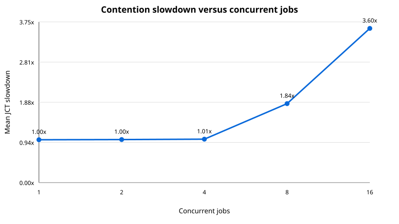

# Collective-contention baseline results

These values were generated by `scripts/run_collective_contention.py` with the
checked-in fixed inputs. Times are simulated time; they are not Docker wall time.

## Training iteration and isolated baseline

The one-iteration trace completed in 2187.534 us: 200 us of configured compute replay plus 1987.534 us in AllReduce.
The three-iteration single-job baseline completed in 6362.602 us. Its measured timing equals 400 us of configured compute replay plus three 1987.534-us AllReduce phases in this uncontended scenario.

## Concurrent-job contention sweep

| Concurrent jobs | Mean JCT (us) | P95 JCT (us) | Mean slowdown | Max slowdown | Jain fairness |
|---:|---:|---:|---:|---:|---:|
| 1 | 6362.602 | 6362.602 | 1.000x | 1.000x | 1.0000 |
| 2 | 6391.649 | 6420.695 | 1.005x | 1.009x | 1.0000 |
| 4 | 6449.742 | 6536.881 | 1.014x | 1.027x | 0.9999 |
| 8 | 11730.527 | 11811.664 | 1.844x | 1.856x | 1.0000 |
| 16 | 22901.272 | 22901.272 | 3.599x | 3.599x | 1.0000 |

The fairness column applies Jain's index to reciprocal JCT (a completion-rate
proxy). The analytical backend's ordinary output does not expose measured
per-link utilization. `communication_and_wait_us` in `per_job_summary.csv` is
JCT minus configured compute replay time; it includes collective transfer time
and contention waiting and must not be described as direct link utilization.

Configuration: 64-NPU Ring, 4 GPUs/job, 50.0 GB/s links, 16777216 bytes/rank/AllReduce.
Simulator commit: `4ce9ecfe746a3ee5fe47559a11d91644d641fa7f`. The recorded `astra-sim-status.txt` is empty, so this run used no simulator source changes.

